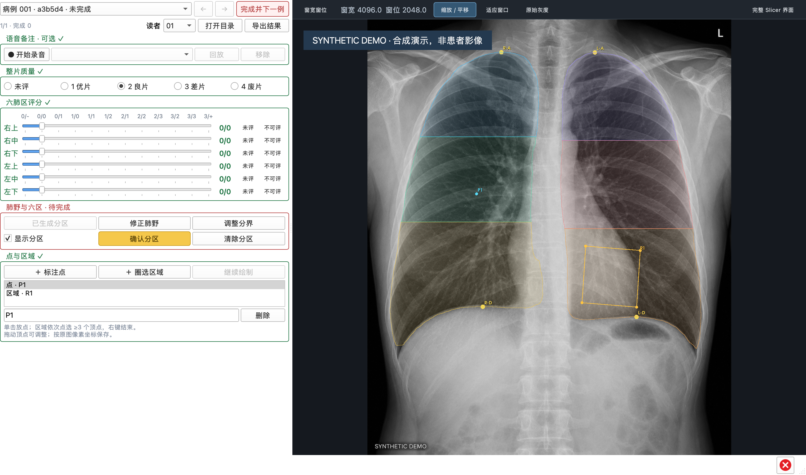

# 尘肺胸片标注 · 3D Slicer

面向科研读片者的单帧 CR/DX 胸片 DICOM 标注模块。一张图像对应每位读者的一条记录，读片、录音和模型推理均在本机完成。



*截图中的胸片由 ImageGen 生成，评分仅为界面演示，不含患者影像，也不用于评价模型准确率。*

## 功能

- 整片质量 1–4 级评价与六肺区 12 小级密集度评分。
- 自动肺野分割和六区划分，支持医生修改肺野、肺尖及膈顶后确认。
- 点与多边形空间标注。
- 本地语音备注，可录多段、回放和移除。
- 多读者独立记录、病例切换与自动保存。
- 导出评分 CSV、空间坐标 CSV、JSON，以及录音和掩膜附件。

## 适用范围与限制

- 用于科研影像标注，不生成诊断、分期、总体密集度或自动密集度评分。功能测试不代表医生验收或分割准确率验证。
- 六区按 GBZ 70-2015 §3.7 的肺尖至膈顶垂直距离划分，属于读片区域，不是肺叶。自动掩膜及初始定位点需要医生核对，不是专家验证的病灶真值。
- 不捆绑标准片，判读须遵循研究协议并使用匹配的标准片；患者左右须核对片内侧别标记。
- 读者编号区分记录，不提供登录或权限控制。受控盲读应使用独立项目目录或工作站。
- 项目使用本地 SQLite；不要在共享网络盘上让多台机器同时写入同一个项目。

## 环境要求

| 项目 | 要求 |
| --- | --- |
| 已验证平台 | macOS，3D Slicer **5.13.0-2026-10-22**；验证范围为功能与持久化 |
| 后台 Python | **3.12.12**，由 [mise](https://mise.jdx.dev/) 固定版本 |
| 磁盘与网络 | 首次下载约 **273 MB 模型权重**；另需 Slicer、依赖及标注数据空间。准备完成后可离线使用 |
| 输入 | 扩展名 `.dcm` 的单帧 CR/DX 灰度 DICOM，支持递归扫描子目录 |
| 录音 | 系统默认麦克风、音频输出及麦克风访问许可 |
| Windows | Windows 11 x64；提供 [离线安装包构建与安装检查](.github/workflows/windows-installer.yml)及[后台自动测试](.github/workflows/windows-x64.yml)。云端界面检查使用软件渲染；目标电脑的显卡和麦克风需单独验收 |

环境分为两层：Slicer 自带 Python 运行界面和影像组件；项目用 **mise → venv → pip** 管理 `.venv` 中的模型及音频依赖，通过后台进程调用。无需向 Slicer Python 或全局 Python 安装这些依赖。直接依赖版本见 [requirements-runtime.txt](requirements-runtime.txt)。

## 快速开始

**Windows 使用离线安装包：**下载 `PneumoconiosisAnnotator-…-Setup.exe`，双击并允许管理员安装，之后从桌面「尘肺胸片标注」启动。包内已带 Slicer、独立 Python、模型与录音依赖和权重，无需另装开发环境。安装包及校验值由手动构建工作流保存到未发布的版本草稿；详见 [Windows 离线安装](docs/usage.md#windows-离线安装)。

**macOS 或源码开发：**

先安装 [3D Slicer](https://download.slicer.org/) 和 [mise](https://mise.jdx.dev/getting-started.html)，下载本仓库并进入项目目录。

**1. 准备环境，一台电脑执行一次：**

```sh
cd slicer-pneumoconiosis
mise install
mise exec -- python scripts/prepare_runtime.py
```

准备脚本创建 `.venv`、安装依赖，并下载、校验 SHA256 和加载模型。

**2. 启动，按实际安装位置填写 Slicer 路径：**

```sh
SLICER_APP="$HOME/Applications/3D Slicer 5.13.0 2026-10-22.app" ./启动尘肺标注.command
```

安装位置与启动器默认值一致时，也可双击 `启动尘肺标注.command`。它负责启动软件，不代替新电脑的环境安装。

**3. 标注一例：**

1. 「打开 DICOM 目录」，再选择自己的读者编号。
2. 点选整片质量；需要补充意见时录入语音备注。
3. 「自动肺野 / 六区」→核对并修正→「确认分区」。
4. 拖动六条滑杆评分；无法评价的区域选择「不可评」。
5. 「完成并下一例」；结束后点「导出结果」。

完整操作与常见问题见 [使用手册](docs/usage.md)。

## 工作流概览

| 环节 | 结果 |
| --- | --- |
| 打开目录、选择读者 | 建立或恢复对应本地项目，切换读者时载入其独立记录 |
| 评分、修正与补充标注 | 修改自动保存；「下一例」允许保留草稿 |
| 完成病例 | 要求质量及六区均已评、已有分区已确认、已有空间标注有效；「不可评」是有效结果 |
| 导出 | 导出当前目录病例列表中，当前读者的记录、修改历史及引用附件，包括未评病例 |

完成条件和保存失败处理见 [完成条件与保存](docs/usage.md#完成条件与保存)。

## 数据与导出

日常标注保存在本地项目中；导出是便于分析和交付的一份快照。一个导出文件夹汇总当前读者的多张胸片，附件通过相对路径关联：

```text
pneumoconiosis-reader-01-<时间>/
├── <同名>.csv               # 评分，每肺区一行
├── <同名>-spatial.csv       # 点 / 多边形顶点
├── <同名>.json              # 完整记录与修改历史
├── assets/                 # 引用的录音与肺野掩膜，存在时生成
└── zone-maps/              # 六区标签图，存在时生成
```

字段、坐标、标签和读取示例见 [数据格式规范](docs/data-format.md)。

## 隐私与数据位置

原始 DICOM 只读，导出不打包原片。源码运行的实际项目位于 `local-data/projects/`，模型位于 `local-data/models/`，功能测试数据位于 `local-data/qa/`；这些目录不纳入 Git。Windows 安装版将记录和录音存入 `%LOCALAPPDATA%/PneumoconiosisAnnotator/`，与程序分离，重装和卸载保留数据。结构化导出不包含源文件路径、患者姓名字段或原始 DICOM UID，但录音保留原声，不自动转写或脱敏。

备份时关闭模块，完整保存项目目录及原始 DICOM；只备份 SQLite 文件会遗漏录音和掩膜。具体目录说明见 [本地项目与备份](docs/usage.md#本地项目与备份)。

## 开发与测试

```sh
.venv/bin/python -m unittest discover -s tests -v
```

测试覆盖持久化、完成条件、六区几何、附件校验、录音恢复及导出。[Windows x64 自动测试](docs/usage.md#windows-x64-自动测试)使用仓库中的合成胸片，验证依赖安装、真实 CPU 模型推理、跨进程保存恢复和完整导出。Slicer 集成脚本和运行方式见 [开发检查](docs/usage.md#开发检查)；其中的功能检查会实际使用麦克风及本地 DICOM 样本。

```text
PneumoconiosisAnnotator/     # Slicer 模块与核心逻辑
scripts/                    # 环境准备、启动及集成检查
tests/                      # 核心逻辑测试
docs/                       # 操作、数据规范与合成演示图
mise.toml                   # 后台 Python 版本
requirements-runtime.txt    # 后台依赖版本
```

变更记录见 [CHANGELOG.md](CHANGELOG.md)。项目处于调试阶段，数据格式允许破坏性调整，不承诺旧版本兼容。

## 致谢与引用

- [3D Slicer](https://www.slicer.org/) 提供影像显示、Markups 和 Segment Editor。平台引用：Fedorov 等，*Magnetic Resonance Imaging*，2012，30(9):1323–1341；见 [官方引用说明](https://slicer.readthedocs.io/en/latest/user_guide/about.html#how-to-cite)。
- [TorchXRayVision ChestX-Det PSPNet](https://mlmed.org/torchxrayvision/models.html#chestx-det-segmentation) 提供肺野初始化；固定权重来源和 SHA256 见 [model_config.py](PneumoconiosisAnnotator/PneumoconiosisLib/model_config.py)。
- 读片分区与评分参考国家卫生健康委发布的 [GBZ 70-2015《职业性尘肺病的诊断》及第 1 号修改单](https://www.nhc.gov.cn/wjw/pyl/202305/ddda1ec278e24a808e12c0ec582d7137.shtml)。
- 演示胸片使用 ImageGen 生成；[原图](docs/img/synthetic-chest.png)和[生成提示词](docs/img/synthetic-chest.prompt.txt)随文档保存。

## 许可证

本项目原创代码和文档采用 [BSD-3-Clause](LICENSE)。这是与 Slicer 同类的宽松 BSD 风格许可证；[Slicer 原协议](https://github.com/Slicer/Slicer/blob/main/License.txt)还包含面向其维护机构的贡献条款，因此没有直接复制为本项目协议。Slicer、第三方依赖及下载模型分别遵循其自身条款。
