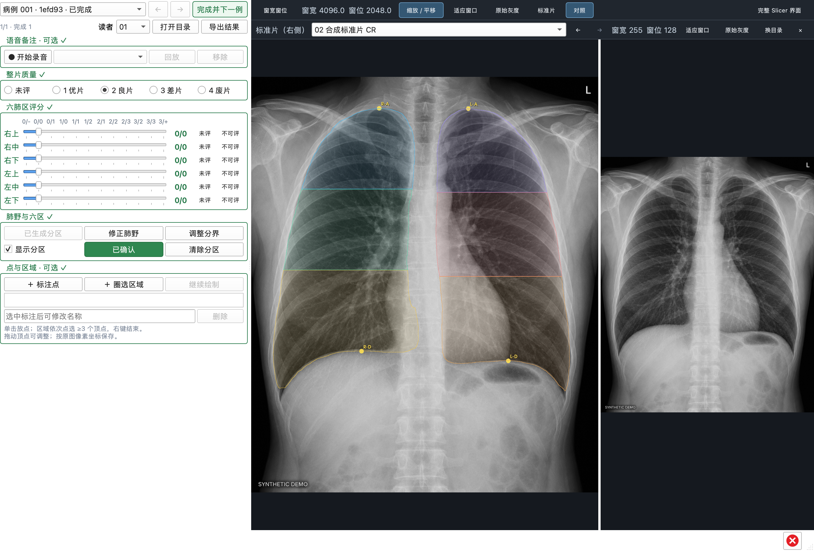

# 使用手册

本手册解释日常操作；环境准备见 [README](../README.md#快速开始)，输出字段见 [数据格式规范](data-format.md)。

## 选择胸片、新建或打开项目

启动默认空白，不自动打开旧项目、示例胸片或标准片。「选择胸片文件夹」扫描所选文件夹及其子文件夹，只选择原片来源，不创建进度或加载胸片。模块只读取扩展名 `.dcm`、单帧、单通道的 CR/DX 灰度 DICOM；其他文件和重复图像会跳过。没有扩展名的 DICOM 不会进入病例列表。扫描跳过数量可在进度文字的提示中查看。

随后点击「新建项目」，选择或新建一个空文件夹保存本次标注；继续已有工作则点击「打开项目」，选择包含 `annotations.sqlite3` 的完整项目文件夹。两个选择窗口都可以取消，不会暗中建立项目。选中有效项目后才加载胸片并启用标注。顶部始终显示原片目录、项目目录和保存状态；所有读者的进度都属于这个项目。

Mac 使用系统原生文件夹窗口，窗口按钮跟随 macOS 的语言；胸片、项目、标准片及导出位置共用这一方式。Windows 保留软件内的中文文件夹窗口。原生选择不会转入 Slicer 的通用数据导入流程。

打开项目时核对整批病例编号与原始文件哈希。选错批次、缺片、增加图片或原片内容变化都会阻止打开；图像和项目可以搬迁或重命名，只要仍是同一整批原片。导出交付包不是项目文件夹，不能用于继续标注。换胸片目录会先保存并关闭当前项目，新的目录需要重新选择项目。

也可以把一个胸片文件夹拖入标注窗口，效果与「选择胸片文件夹」相同。日常界面隐藏通用 Slicer 菜单；需要原生工具时展开「完整 Slicer 界面」，使用后点「返回标注界面」。中文资源随程序提供，离线可用，无需另选语言或安装语言插件。

姓名、检查描述等 DICOM 文件内容与软件按钮的语言是两回事。符合声明的 UTF-8 和 GB18030 中文已纳入读取检查；文件本身若错误声明字符编码，原生信息列表仍可能乱码，需核对数据来源，程序不猜改患者信息。科研标注界面使用病例编号，不要求医生选择字符编码。

从 Mac 传到 Windows 的压缩包，解压后可能带有 `__MACOSX` 目录及 `._` 开头的辅助文件。模块会自动忽略它们，可以直接选择包含真实胸片及这些辅助文件的解压目录；不需要删除辅助文件。选中辅助目录本身时会提示重新选择。中文和空格目录与文件名均可使用。

打开项目后，从进度行的「读者」选择 01–10。显示编号 01 对应数据中的 `reader-01`，其他编号依此类推。每位读者固定使用自己的编号；更换编号后，评分、录音、空间标注和分区修订分别恢复。

病例下拉框用于跳转，左右箭头用于前后切换。「下一例」保存草稿，不要求先填完；「完成并下一例」按完成条件检查后再跳转。进度按当前读者计算；对参与导出的读者，当前病例列表中的未评病例也会出现在其导出结果中。

启动器使用独立设置，不修改日常 Slicer 配置。退出前先保存标注及录音；成功后直接退出，不再询问是否保存 Slicer 场景。保存失败则停留在当前窗口并保留输入，显示错误与「重试保存」。手动将插件加载到普通 Slicer 时，仍保留普通 Slicer 的场景管理。

## 整片质量与六肺区评分

整片质量直接选择：1 优片、2 良片、3 差片、4 废片，也可点回「未评」。质量与密集度分开记录，质量等级不是病变分期。各等级都可以满足质量评价这一项，不要求填写缺陷原因。

六肺区分别是患者右上、右中、右下、左上、左中、左下。六条滑杆共用一个带文字的标尺，12 档依次为：

```text
0/-  0/0  0/1  1/0  1/1  1/2  2/1  2/2  2/3  3/2  3/3  3/+
```

拖动并松开即保存；滑杆聚焦后，也可用左右方向键逐档调整。右侧数值是实际评分。默认状态是「未评」，滑杆初始位置不代表已评分。鼠标滚轮不会更改评分，避免滚动面板时误改。

「未评」清空该区评分并使其未完成；「不可评」记录一次有效的不可评价结论，可以完成病例。两者都不等于 `0/0`。如需解释原因，使用可选的语音备注，无需填写文字或录音才能提交。

## 肺野与六区

点「自动肺野 / 六区」后，模型在本机后台运行。可以继续查看其他病例，结果只关联其来源胸片；再次查看时恢复对应缓存。模型不会填写整片质量或六区密集度。

自动结果以六色叠加显示。核对患者左右、肺野范围及四个定位点：R-A / L-A 是右 / 左肺尖，R-D / L-D 是右 / 左膈顶。分界由各侧肺尖到膈顶的垂直距离三等分计算，叠加仅保留肺野内的部分。

| 操作 | 用途 |
| --- | --- |
| 修正肺野 | 打开原生 Segment Editor，选择患者右肺或左肺，用 Paint / Erase 修改；支持编辑器撤销 |
| 调整分界 | 解锁定位点，在图上拖动肺尖、膈顶；六区随定位点重新计算 |
| 显示分区 | 控制叠加可见性，不删除分区数据 |
| 确认分区 | 核对完成后确认；黄色表示待确认，绿色表示已确认 |
| 清除分区 | 清除当前记录的分区，使本次完成不再要求确认；已保存修订可在历史中追溯 |

任何肺野或定位点修改都会撤销确认，按钮重新变黄，需要再次确认。机器初始肺野和定位点分别保留，医生修正不覆盖初始结果；不同读者的修正和确认独立。膈顶初始点仅为算法估计，需要人工核对。

## 小阴影标注

「+圆形小阴影」使用 ExtraMarkups 的原生圆形工具。在胸片上点选直径的两个端点，第二次点击后完成；拖动端点可调整圆的位置和大小。图形旁和列表中显示“直径”，缩放、平移或调整后自动更新。图像平面由程序固定，不需要额外点选第三个辅助点。

「+不规则小阴影」使用 Slicer 原生闭合曲线创建直边多边形：沿边界依次点选至少三个顶点，右键结束。拖动顶点可修改；图旁显示“宽度”，计算方式为轮廓凸包的最小卡尺宽度，即包住整个轮廓的两条平行线之间的最小距离。这是几何估计值，不自动判定 s/t/u 等临床类别。

尺寸优先采用 DICOM 的 Pixel Spacing；只有 Imager Pixel Spacing 时标为“mm（探测器）”，均缺失或无效时显示 px。毫米值反映文件记录的尺度，校准状态随数据保存，不由软件假定；它不能自行纠正胸片的投影放大。相应语义见 [DICOM 像素间距规范](https://dicom.nema.org/medical/dicom/current/output/chtml/part03/sect_10.7.html)。

已有标注逐条列出，可改名、删除、继续绘制。未完成或无效轮廓保存为草稿，不显示有效尺寸，也不能提交病例完成状态。旧版单点或椭圆不会自动变成圆形；含这些旧标注的病例会提示使用独立的新标注项目，原数据保留。

打开目录、切换上一张 / 下一张胸片、切换读者或标准片、导出时，软件显示覆盖整个窗口的居中提示框，暂时禁止其它操作。操作完成或失败后自动恢复；LabelMe 导出另外提供进度和取消按钮。

## 语音备注

录音位于病例导航下方、整片质量上方。「开始录音」使用系统默认麦克风，按钮显示时长；停止后可从列表选择录音并回放或移除。一例可以录多段，录音与胸片和读者共同关联。

切换病例、切换读者或关闭前会先停止并保存录音。第一次使用须允许麦克风访问；失败时检查系统麦克风许可和默认输入设备。录音不做转写，评价及不可评原因可直接口述，录音本身是可选项。

录音分块刷盘，意外中断后重新打开同一项目会检查可恢复片段。有效片段作为中断录音恢复，不添加空音频。移除只影响当前记录；已保存历史所引用的音频可能仍被保留并包含在导出中。

## 完成条件与保存

「完成并下一例」检查下表。未满足的区域标红，已满足标绿并显示 ✓；六个评分行也分别反馈状态。按钮汇总缺项，悬停可查看说明。

| 区域 | 满足条件 |
| --- | --- |
| 整片质量 | 已选 1–4 级任意一级 |
| 六区评分 | 每区都已评分或选「不可评」，没有「未评」 |
| 肺野与六区 | 未生成分区，或已有分区已由当前读者确认 |
| 小阴影标注 | 留空，或每个已有标注都有效；区域无未完成、交叉等几何问题 |
| 语音备注 | 不要求录音；正在录音时先停止并成功保存 |

分区、圆形 / 多边形和录音是可选项，空白不会新增必填要求。完成后的医学标注若再次修改，会恢复为草稿；单纯查看时的缩放、平移及灰度调整不改变完成状态。

滑杆评分立即保存；质量及空间修正一般在停止修改约半秒后保存，切换前会主动刷新。顶部常驻显示「正在保存」「草稿 · 已自动保存」「已完成 · 已自动保存」等状态。保存失败时显示红色错误和「重试保存」，并阻止切换病例、读者、项目及关闭，当前输入保留。排除磁盘、权限或附件问题后重试，不要把失败提示当作已保存。

## 看图工具与完整 Slicer 界面

胸片上方的工具栏提供：

| 工具 | 用法 |
| --- | --- |
| 窗宽窗位 | 在片上按住左键拖动；实时显示数值，仅改变显示亮度与对比度 |
| 缩放 / 平移 | 滚轮缩放、中键拖动平移 |
| 适应窗口 | 恢复完整胸片的视野 |
| 原始灰度 | 恢复加载该片时的窗宽、窗位与灰度映射 |
| 完整 Slicer 界面 | 展开原生工具栏、模块选择器和视图控制；「返回标注界面」返回 |

选择查看工具会结束放点 / 圈选或关闭肺野编辑；进入放置模式时，查看模式的高亮会取消。切换完整界面不清空评分和标注，切到其他模块后仍可从图像上方返回。

图像按存储的像素方向显示，不把缺失的三维方位信息当作已知解剖方位。像素坐标不随查看操作改变，左右请核对片内标记。

## 标准片对照

1. 点击图像上方「标准片」，选择外部标准片文件夹。递归读取单帧灰度 DICOM，包含 CR、DX、OT 等类型，支持 `.dcm`、`.dicom` 和无扩展名文件；自动跳过 Mac 压缩包辅助文件。
2. 左侧显示正在标注的胸片，右侧显示标准片；从「标准片（右侧）」列表选择文件，或用旁边的箭头切换。
3. 「窗宽窗位」模式下，在要调整的那张图上左键拖动；滚轮缩放，中键拖动平移。两侧独立操作。上面一行的「适应窗口」「原始灰度」作用于当前胸片，标准片所在一行的同名按钮作用于标准片。
4. 点击「对照」或标准片行的「×」收起右侧，再点「对照」恢复；「换目录」选择另一套标准片。

目录、选中片和对照开关会保存在本机，下次明确打开标注项目后恢复，空白启动时不加载。切换病例或读者不会替换右侧标准片。目录移动、磁盘离线或新目录不可读取时会显示提示，仍可继续标注当前胸片或重新选择标准片目录。

标准片只用于查看，不加入病例列表、不参与模型推理、不填写或自动推断评分，也不复制到标注项目、安装包或导出结果。圆形、多边形、肺野修正和六区叠加仅作用于当前胸片。请自行核对标准片的来源、版本和研究协议；文件名中的分期不转换为六区评分。



*上图的「标准片」是用于功能演示的合成 DICOM，不是判读用标准片，也不代表医生验收。*

## 导出

「导出交付包」是医院交给 AI 研究者的结果包，只包含标注、引用附件和原片对照表，原始 DICOM 胸片另行交付。导出不会改变当前标注项目或保存位置。根目录的 `交付说明.txt` 解释每种文件及关联方式；`manifest.json` 记录时间、病例数、各读者的完成 / 草稿 / 未评数量，以及包内每个文件的 SHA-256。导出不强制所有病例完成，也不把未评视为阴性；分析时按 JSON 的 `reading_state` 筛选。

「导出交付包」选择目标文件夹，生成一个只以日期时间命名的独立目录，例如 `20261028-153045-123456`，里面按 `reader-01`、`reader-02` 等编号分子目录。一次包含当前病例列表中所有有实际阅片记录的读者，不受界面当前读者限制；每位参与读者仍保留该列表的未评病例、草稿、已完成记录和修改历史。

参与依据是已保存的评分或不可评价、质量评价、圆形 / 多边形标注、录音，或人工修改 / 确认分区；修改历史中有这些内容也会保留该读者。仅切换编号、浏览、调整窗宽窗位 / 缩放，或只有未经修改或确认的机器分区，不会产生读者导出目录。没有实际阅片记录时显示提示，不生成空导出包。

每个读者子目录中，评分 CSV 适合表格分析；原片对照表 `*-images.csv` 按 `case_id` 对应原始胸片；空间 CSV 记录点和顶点；JSON 保留该读者的完整结构及历史；WAV、肺野掩膜和六区标签图通过相对于该读者子目录的路径关联。交付时保留整个导出文件夹，勿只移动 JSON。详细作用及字段见 [数据格式规范](data-format.md)。

对照表每张胸片一行，包含原片相对路径和文件 SHA256。路径相对于打开胸片时选择的目录，例如 `./批次 A/胸片.dcm`；在该目录下按路径即可找到原片，与导出文件夹的位置无关。原片整体搬移后，保留内部目录结构即可继续使用对照表。它包含原文件名和子目录名，应与原始数据一起保管。

## LabelMe 导出

点击顶部独立的「导出 LabelMe」，选择输出目录。导出先保存当前输入，再读取一个固定快照；后台转换图像，窗口显示进度并提供取消。完成后打开结果目录。读者范围与「导出交付包」相同：当前病例列表中有实际阅片记录的所有读者，每位读者都保留整份病例列表，未评病例也会生成图像和空标注。

```text
20261028-153045-123456/
├── export-report.json       # 原片关联、转换参数、每例状态和跳过轮廓的原因
├── reader-01/
│   ├── CXR-….png            # 固定灰度转换的查看图，保持原始宽高和像素顺序
│   └── CXR-….json           # 该读者的当前圆形和有效多边形
└── reader-02/               # 其他参与读者，图像与各自标注放在一起
```

在 LabelMe 中选择 Open Dir，打开 `reader-01` 等读者目录即可逐张查看。文件名沿用 `case_id`，JSON 用同目录相对路径引用 PNG，不嵌入重复图像数据。正方形像素的圆形导出为 LabelMe 原生 `circle`（圆心和圆周一点）；行列像素间距不同时，为保持与原始图像的对应关系，导出为 128 点多边形轮廓。原始直径端点、来源类型和测量值作为扩展字段一同保留。圆形和轮廓保留原标签与小数坐标；未画完、自交等无效多边形不会转换，报告逐项记录原因，原始项目中的草稿仍然保留。文件缺失、原片内容变化、读取失败或坐标损坏会停止整次导出，不生成看似完整的结果；失败或取消时可能留下隐藏的 `.partial-labelme-*` 临时目录。

该功能只交换当前人工空间标注，不携带肺野 / 六区掩膜、评分、录音或修改历史，也不将 LabelMe 中的修改写回项目。完整研究数据请使用「导出交付包」。空 `shapes` 只表示没有导出的空间标注，不能当作阴性病例；完成状态见 JSON 的 `flags.case_complete` 和报告。PNG 使用固定 DICOM 灰度转换，不采用各读者临时调整的窗宽窗位，不替代原始 DICOM。

格式按 LabelMe **7.9.1** 的文件读取规则验证；其它读取程序仍需检查是否支持 `polygon`。格式字段与转换规则见 [LabelMe 数据规范](data-format.md#labelme-独立导出)。

## 本地项目与备份

项目在「新建项目」时选择的位置，源码版和 Windows 安装版均如此。继续标注时选择原片目录，再打开这个项目文件夹：

```text
自选的项目文件夹/
├── annotations.sqlite3  # 所有病例、各读者进度与修订历史
├── assets/audio/        # 录音附件
├── assets/masks/        # 不可变肺野掩膜
├── dicom-cache/         # 本地 DICOM 读取缓存
└── model-inputs/        # 本地模型输入，可含影像像素
```

原始胸片保持在另行选择的文件夹中，不复制进项目。旧项目目录不会移动或删除，已有 `annotations.sqlite3` 的项目可用「打开项目」选择；其格式仍须受当前版本支持。模型与测试数据仍在源码仓库的 `local-data/models/`、`local-data/qa/`；标准片偏好和启动日志使用源码 `local-data/` 或 Windows `%LOCALAPPDATA%/PneumoconiosisAnnotator/`，与用户项目分开。

备份前关闭使用该项目的标注窗口，再复制完整项目目录及原始 DICOM。运行中备份须使用 SQLite 在线备份机制并保留相关附件，不能只复制活动数据库文件。导出主要用于分析和交付，不是界面支持的项目导入 / 恢复格式；恢复工作环境需要本地项目和原图。

## 安装与启动排查

普通评分使用 Slicer 内置组件；源码版的模型、录音和回放使用项目 `.venv`，Windows 安装版使用随包提供的独立运行环境。源码版出现依赖或权重未准备提示时，在仓库目录重新运行 `mise exec -- python scripts/prepare_runtime.py`。脚本不使用全局 Python；Windows 使用 `requirements-windows-lock.txt` 固定完整依赖版本，其他平台仅固定直接依赖。

Mac 启动路径不同时，用 README 的 `SLICER_APP=... ./启动尘肺标注.command` 命令指定。终端中的临时环境变量不会自动传给另一次 Finder 双击启动。如手动添加模块，必须同时加载与当前 Slicer 版本匹配的 ExtraMarkups；建议使用项目启动器，它会一起加载所需扩展。

「项目正由另一个窗口使用」表示项目锁阻止并行写入，先关闭使用该项目的其他窗口。该锁不构成跨网络盘的多机协作机制。

## 开发检查

核心测试命令见 README。集成检查在独立 Slicer 进程内运行，使用仓库相邻的 `2023Sample`，结果写入忽略的 `local-data/qa/`。按每组的检查脚本、恢复脚本顺序执行：

| 检查 / 新进程恢复 | 范围 |
| --- | --- |
| `slicer_smoke.py` / `slicer_restore_check.py` | 病例、评分、保存与导出 |
| `slicer_spatial_check.py` / `slicer_spatial_restore.py` | 原生鼠标放圆形、多边形、编辑、切换与持久化 |
| `slicer_features_check.py` / `slicer_features_restore.py` | 真实模型推理、肺野修正、确认、约一秒实际录音及回放 |
| `slicer_labelme_check.py` | 合成胸片、鼠标绘制和拖动圆形、尺寸标注、换片提示及失败恢复、实际 LabelMe 导出与多读者隔离 |
| `slicer_project_check.py`（正常启动，不加 `--testing`） | 合成胸片；空白启动、真实项目选择、保存失败阻止退出、重新打开及交付包 |

项目流程检查需指定同一个新的 `PNEUMO_WORKFLOW_OUT` 目录，以及独立的 `PNEUMO_DATA_ROOT`；先用 `PNEUMO_WORKFLOW_PHASE=create` 运行，再用 `reopen` 在新 Slicer 进程运行。脚本通过真实窗口关闭结束进程，两次报告均应为 `passed`。

Mac 的项目检查用系统 Swift 编译测试驱动，通过真实原生窗口选择中文目录，需要终端宿主已有辅助功能权限；只对指定测试进程操作，失去其焦点会停止发送按键。可用 `swiftc -module-cache-path /tmp/pneumo-swift-cache scripts/macos_accessibility_probe.swift -o /tmp/pneumo-ax-probe` 编译只读辅助功能探针，再设置 `PNEUMO_AX_PROBE=/tmp/pneumo-ax-probe` 同时测试 `AXSelectedChildren` 等跨进程查询。探针只访问测试 Slicer，结果写入该次检查目录，不修改系统设置。

例如在 macOS 上执行第一个脚本（先在终端设定实际的 `SLICER_APP`，随后分别替换脚本名）：

```sh
MODULE_PROJECT="$PWD"
MARKUPS_MODULES="$MODULE_PROJECT/local-data/extensions/ExtraMarkups/lib/Slicer-5.13/qt-loadable-modules"
export DYLD_LIBRARY_PATH="$MARKUPS_MODULES${DYLD_LIBRARY_PATH:+:$DYLD_LIBRARY_PATH}"
cd "$MODULE_PROJECT/local-data"
"$SLICER_APP/Contents/MacOS/Slicer" \
  --disable-settings --ignore-slicerrc --no-splash --testing \
  --additional-module-paths "$MARKUPS_MODULES" "$MODULE_PROJECT/PneumoconiosisAnnotator" \
  --python-script "$MODULE_PROJECT/scripts/slicer_smoke.py"
```

当前主界面截图使用 `scripts/slicer_labelme_check.py` 的合成病例素材，在实际模块中打开并验证后截取；含肺野叠加的完整演示截图使用 `scripts/capture_docs_preview.py`：将仓库内的 ImageGen 合成 PNG 封装成独立演示 DICOM，在独立项目中调用真实插件并截图。它不打开患者样本、不录音、不改动实际标注项目；合成输入和截图不能用于模型准确率验证。

安装后的正常界面检查还调用 `packaging/windows/reference_check.py`，用合成 OT / CR 标准片验证实际目录窗口、独立窗宽窗位、滚轮缩放、病例切换、只读标注隔离、目录记忆与丢失后的恢复；标准片原文件的哈希在检查前后保持一致。

`packaging/windows/language_check.py` 检查正常启动后的面板、真实文件夹拖放、中文菜单和文件窗口，以及原生 DICOM 读取 UTF-8 / GB18030 中文的结果。中文源文件、来源版本和许可证在 `PneumoconiosisAnnotator/Resources/Translations/`；修改翻译后用 Slicer 自带的 `lrelease` 运行 `scripts/build_translations.py` 重新生成 `.qm`。Windows 打包时会用随包 Qt 工具重新编译。

## Windows x64 自动测试

[工作流](../.github/workflows/windows-x64.yml)使用 GitHub 的 `windows-2022` x64 环境。相关代码、依赖、Python 配置或合成胸片推送到 `main` 时运行，也可在仓库 Actions 页手动执行。相同分支的新运行取消前一轮；仅修改普通文档不会触发。

工作流通过 mise 安装 `mise.toml` 中固定的 Python，再运行正式的环境准备脚本。缓存的是安装包和模型权重，虚拟环境每次重新创建、安装，模型每次校验 SHA256。随后执行依赖一致性检查、核心单元测试和 [合成病例集成检查](../tests/synthetic_pipeline.py)。

集成检查将 ImageGen 合成胸片封装为 DX DICOM，验证中文路径、像素读取、真实后台模型协议、六区掩膜、确认前禁止完成、保存后在新 Python 进程恢复，以及 CSV / JSON / NPZ / WAV 导出与附件哈希。评分、确认和音频由测试明确生成；测试不推导临床评分，也不使用麦克风。

本地可在准备好运行环境后执行同一检查，下面是 Windows PowerShell 命令：

```powershell
mise exec -- python scripts/prepare_runtime.py
& .\.venv\Scripts\python.exe -m pip install -r requirements-test.txt
& .\.venv\Scripts\python.exe -m unittest discover -s tests -v
& .\.venv\Scripts\python.exe tests/synthetic_pipeline.py --output local-data/qa/windows-x64
```

运行报告、工作进程日志、合成项目和导出保存在 `local-data/qa/windows-x64/`；CI 将此目录作为 `windows-x64-synthetic-*` 附件保存三天，并在运行摘要中列出检查结果。权重和虚拟环境不进入附件。

该测试覆盖 Windows 后台流程，不安装或启动 Slicer GUI，不代表图形驱动、鼠标交互、屏幕缩放、真实录音或临床分割准确率已经验收。上述项目需在目标 Windows 电脑上另行测试。

## Windows 离线安装

安装包从 0.2.1 起允许 **Windows 10 1903（内部版本 18362）及以上的 64 位系统**安装，包括 Windows 10 22H2、Windows 10 LTSC 2021 和 Windows 11。下载 `PneumoconiosisAnnotator-<版本>-windows-x64-<提交>-Setup.exe` 及对应 `.sha256` 校验文件，双击安装包并允许管理员安装，安装完成后从桌面「尘肺胸片标注」进入。日常使用不需要管理员权限，也无需安装 Python、mise 或额外的 Slicer。模型权重及依赖均随包提供，安装和模型推理可离线执行；模型使用 CPU，无需 CUDA。

默认程序目录是 `C:\Program Files\PneumoconiosisAnnotator`。Slicer 的程序路径须使用英文，病例和用户数据目录可以使用中文。首次打开后选择自己的胸片目录，新建或打开项目，再选择读者编号；程序不会把合成病例当成真实标注项目。

同一 Windows 会话只打开一个安装版标注窗口。启动期间再次双击不会再打开第二个窗口；窗口已打开时，启动器会尝试将其恢复到前台。

标注数据位于用户选择的项目目录，备份及原始 DICOM 的要求与源码版相同。应用偏好与日志位于 `%LOCALAPPDATA%/PneumoconiosisAnnotator/`，启动日志在其 `logs/` 子目录内；重装和卸载保留这些外部数据。安装包尚未做代码签名，Windows 可能显示未知发布者提示。

### Windows 版本依据与验证范围

最低版本配置集中在 [inputs.json](../packaging/windows/inputs.json) 的 `windows` 字段，由构建脚本传给安装器并记录进构建清单。此前的 `10.0.20348` 对应构建服务器的系统版本，会误拦 Windows 10 22H2；它不是程序本身必须使用的系统接口下限。0.2.1 将门槛降为 `10.0.18362`，低于门槛时显示具体要求。

| 组件 / 功能 | 本次核对的依据 |
| --- | --- |
| Slicer 5.13.0 r35392、中文病例及用户目录 | 固定源码的 [UTF-8 测试](https://github.com/Slicer/Slicer/blob/46891eee252d28fa8c2a89ddd98d8f85e8fc7064/Libs/MRML/Widgets/Testing/qMRMLUtf8Test1.cxx)明确指出 Windows 10 1903 以前不具备预期的进程 UTF-8 代码页；[微软文档](https://learn.microsoft.com/en-us/windows/apps/design/globalizing/use-utf8-code-page)确认该能力从 1903 开始提供。这决定当前完整中文工作流的最低目标 |
| Python 3.12 | Slicer 内置 3.12.10，后台固定 3.12.12；[Python 官方说明](https://docs.python.org/3.12/using/windows.html)最低为 Windows 8.1，本身不要求 Windows 11 |
| 模型及音频库 | 保持 0.2.0 已交付包的版本，包括 Torch 2.14.1 CPU、NumPy 2.5.4、SciPy 1.18.1 和 sounddevice 0.5.6，并固定传递依赖；库版本与安装门槛不能代替旧系统上的实际加载和运行检查 |

Windows 7、8、8.1，以及 Windows 10 1809 / LTSC 2019 和更早版本，暂不在当前完整中文工作流的支持目标内。这个结论不等于每个组件都无法在这些系统启动。Slicer 上游当前以 Windows 11 为受测平台，[明确表示旧系统可能仍可运行，但不再测试](https://slicer.readthedocs.io/en/latest/user_guide/getting_started.html#operating-system-versions)。本项目因此将安装门槛与实际验证证据分开记录。

目前自动化运行环境是 **Windows Server 2022 x64**。Windows 10 1903、LTSC 2021、22H2 的实机验收尚待完成，不能将服务器上的通过结果当作这些版本已验证。图形驱动还需提供 OpenGL 3.2 或以上；真实麦克风和录音须在目标电脑检查。界面检查报告记录操作系统、构建号、进程代码页和实际渲染器，检查 Slicer 使用 UTF-8 后再验证中文目录、标准片、推理、保存和导出。

### 构建与安装验证

[Windows offline installer](../.github/workflows/windows-installer.yml)工作流只在手动执行时构建大安装包，普通代码推送仍运行轻量后台检查。固定 Slicer、Inno Setup 和测试用 Mesa 的版本、下载地址与哈希见 [inputs.json](../packaging/windows/inputs.json)。后台环境使用 mise 提供的可迁移 standalone Python，加上 Windows 依赖锁定文件；不会复制开发环境的 venv 启动器。

流水线先运行核心测试，再生成安装包，安装到新目录，核对全部程序文件哈希，并对已安装的后台进程阻断出站网络，运行合成病例。随后通过正式启动器以正常界面模式打开安装后的 Slicer，验证重复启动只有一个实例，并实际点击「选择胸片文件夹」，通过文件夹选择窗口选择带中文、空格及 Mac 辅助文件的合成目录，明确新建项目，再检查真实 QProcess 模型推理、六区、确认、保存和导出，最后验证重装与卸载保留外部数据。界面检查临时使用 Mesa 软件 OpenGL，Mesa 不包含在交付安装包中；真实显卡、麦克风和医生验收另行进行。

成功产物包括单文件 EXE、SHA256、构建清单和检查报告，保存为 GitHub Release **未发布草稿**，以减少大型 Actions 附件存储。失败诊断作为短期 Actions 附件保存。产物不包含真实胸片、标注库或录音，唯一影像样例为 ImageGen 合成素材。
